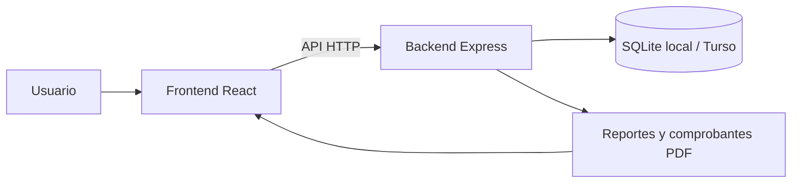
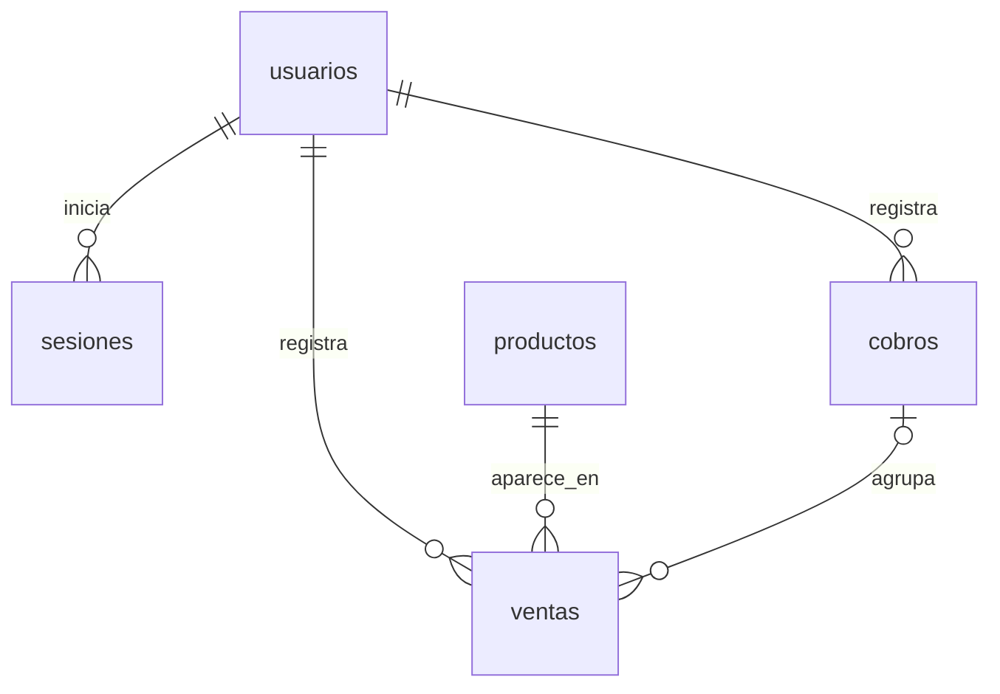

# PeruFarma — Sistema de gestión para boticas

**Aplicación web para administrar productos, controlar existencias y registrar ventas desde una intranet.**

El proyecto nació como **Nova Salud Sistema** y actualmente utiliza la identidad visual de **PeruFarma**. Integra inventario, punto de venta, alertas e informes en una interfaz con barra lateral y diseño adaptable a computadoras y dispositivos móviles.

## Problema que aborda

El registro manual de ventas y existencias dificulta conocer qué productos están disponibles, detectar faltantes y consultar los resultados del negocio. PeruFarma reúne estas tareas en una aplicación que relaciona cada venta con sus productos y con el usuario que la registra.

## Objetivo del proyecto

Facilitar la operación diaria de una botica mediante el control de inventario, el registro de compras con varios artículos y la consulta de ventas por período.

## Funcionalidades implementadas

| Apartado | Funciones principales |
| --- | --- |
| Acceso | Inicio de sesión con usuarios registrados y cierre de sesión. |
| Inicio | Resumen de la actividad y del estado del inventario. |
| Inventario | Registro y consulta de productos, precios, existencias y stock mínimo; reposición de unidades. |
| Punto de venta | Búsqueda rápida de productos, carrito con varios artículos, edición de cantidades y validación de existencias. |
| Pagos | Registro del medio de pago: efectivo, Yape / Plin o tarjeta; cálculo de vuelto para efectivo. |
| Alertas | Identificación de productos agotados o por debajo del stock mínimo. |
| Historial | Consulta de operaciones registradas y descarga de comprobantes internos en PDF. |
| Reportes | Consulta por fechas, importe vendido, operaciones, unidades vendidas, venta promedio y exportación a PDF. |

Los medios de pago se registran de forma manual: la aplicación no procesa tarjetas ni confirma transferencias de Yape o Plin. Los comprobantes PDF son documentos internos y no sustituyen comprobantes tributarios.

## Flujo de uso

1. El usuario ingresa con sus credenciales.
2. Consulta el inventario y las alertas de existencias.
3. Busca productos y los agrega al carrito.
4. Revisa cantidades, selecciona el medio de pago y confirma la venta.
5. El sistema registra la operación y descuenta las unidades del inventario en una misma transacción.
6. El usuario consulta el historial y genera reportes o documentos PDF.

## Tecnologías utilizadas

| Capa | Tecnologías | Responsabilidad |
| --- | --- | --- |
| Frontend | React, Vite, React Router, Tailwind CSS y CSS | Interfaz, navegación y formularios. |
| Comunicación | Axios y API HTTP | Intercambio de información entre frontend y backend. |
| Backend | Node.js y Express | Autenticación, reglas del negocio y acceso a datos. |
| Base de datos | SQLite local o Turso mediante `@libsql/client` | Persistencia de usuarios, productos y operaciones. |
| Documentos | PDFKit | Generación de reportes y comprobantes internos. |
| Iconografía | Lucide React | Iconos de navegación y acciones. |

## Arquitectura

El frontend y el backend son aplicaciones separadas. El navegador consulta la API; el backend valida la sesión, ejecuta las operaciones y accede a la base de datos.

La distribución prevista para el alojamiento es **Vercel para el frontend**, **Render para el backend** y **Turso para la base de datos remota**. Las direcciones de conexión se configuran mediante variables de entorno. Las credenciales de la base de datos permanecen en el backend.

## Modelo de base de datos

El esquema incluye siete tablas. `demo_cargas` se crea al ejecutar la carga de datos simulados.

| Tabla | Propósito | Conexiones |
| --- | --- | --- |
| `usuarios` | Guarda el identificador de acceso, nombre y contraseña protegida. | Se relaciona con sesiones, cobros y líneas de venta. |
| `sesiones` | Permite validar las sesiones activas y su vencimiento. | Cada sesión pertenece a un usuario. |
| `productos` | Almacena nombre, precio, stock y stock mínimo. | Un producto puede aparecer en muchas líneas de venta. |
| `cobros` | Representa una compra completa: total, vendedor y medio de pago. | Pertenece a un usuario y agrupa sus líneas de venta. |
| `ventas` | Guarda cada artículo vendido, cantidad y subtotal. | Se conecta con productos, usuarios y, para las operaciones actuales, cobros. |
| `intentos_login` | Controla los intentos de acceso por dirección IP protegida mediante hash. | No tiene claves foráneas. |
| `demo_cargas` | Registra las cargas de datos de demostración para evitar repetirlas. | No tiene claves foráneas. |

### Relaciones principales

**Una compra puede contener varios artículos:** `cobros` guarda la cabecera de la operación y `ventas` guarda sus detalles. Las ventas históricas pueden tener `cobroId` vacío por compatibilidad con el modelo anterior. La aplicación crea al menos una línea por cada nuevo cobro.

Los importes se almacenan como números enteros en centavos para evitar errores de redondeo. Las líneas de venta conservan el nombre del producto y del vendedor utilizado al registrar la operación.

## Integridad y acceso

- Las contraseñas se almacenan mediante una derivación criptográfica con **scrypt y sal**, no como texto legible.
- Las sesiones tienen vencimiento y su token se almacena como hash en la base de datos.
- Las rutas de negocio del backend requieren una sesión válida.
- El inicio de sesión limita los intentos para reducir los accesos repetidos.
- La confirmación de una compra registra sus artículos y actualiza el stock dentro de una transacción.
- Una clave única por usuario y solicitud permite reintentar un cobro sin duplicar la operación.
- Las restricciones de la base de datos impiden cantidades e importes inválidos y existencias negativas.

## Ejemplo de una venta

| Producto ilustrativo | Cantidad | Precio unitario | Subtotal |
| --- | ---: | ---: | ---: |
| Producto A | 2 | S/ 1.50 | S/ 3.00 |
| Producto B | 1 | S/ 6.50 | S/ 6.50 |
| **Total** | **3** | | **S/ 9.50** |

Si el cliente entrega **S/ 10.00**, el vuelto es **S/ 0.50**. El sistema crea un cobro, registra dos líneas de venta y descuenta dos unidades del producto A y una del producto B.

## Datos de demostración

El proyecto dispone de un proceso de carga de productos y ventas ficticias para mostrar el inventario, las alertas, el historial y los reportes. Estos datos se utilizan para demostraciones y no representan operaciones comerciales reales.

## Validación realizada

Se verificaron la compilación del frontend, la revisión de código y pruebas del backend sobre transacciones, reintentos y consistencia de las ventas. También se revisaron la navegación adaptable, el comportamiento del carrito y la generación de documentos PDF.

## Alcance actual y mejoras futuras

La versión actual se centra en inventario y ventas. Como ampliaciones se proponen:

- Administración de permisos y roles de usuario.
- Registro de clientes, proveedores y categorías.
- Control de lotes y fechas de vencimiento.
- Historial de movimientos de inventario y auditoría.
- Integración con servicios de pago y facturación electrónica.

Los reportes actuales muestran **ventas e inventario**, pero no calculan utilidad: el modelo todavía no registra el costo de adquisición de los productos.

## Guion sugerido para la presentación

1. **Contexto:** explicar las dificultades del control manual de inventario y ventas.
2. **Propuesta:** presentar PeruFarma y sus módulos principales.
3. **Demostración:** iniciar sesión, consultar existencias y realizar una venta con varios artículos.
4. **Resultados:** mostrar el descuento de stock, el historial y un reporte PDF.
5. **Diseño técnico:** explicar frontend, backend, base de datos y la relación entre cobros y ventas.
6. **Proyección:** presentar las mejoras futuras y el alcance de la versión actual.
